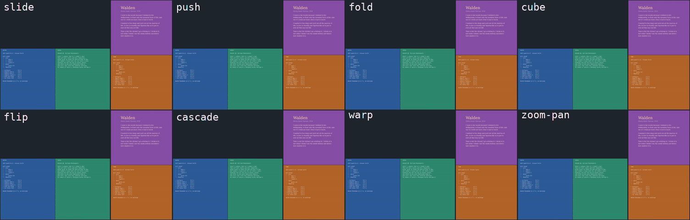

# ws-direction

A [picom](https://github.com/yshui/picom) plugin that tells animation scripts which way a
workspace switch went, and which monitor a window's workspace is on. With it a `show` or
`hide` animation can move windows the right way and keep them on their monitor. It also
tells them where a window's workspace is among the monitor's workspaces, for effects
that draw the workspaces a switch passes. picom itself knows nothing about workspaces:
the plugin reads the window manager's EWMH properties and hands the scripts fourteen
numbers. What the scripts do with them is up to you; `styles/` has seven switch styles
to start from, and the `ws-direction` command opens and closes the overview.

The GIFs are recorded on Xvfb with i3 and picom's xrender backend, at a quarter of a
3440x1440 + 1080x1920 layout, with the windows cropped below the i3 bar, and cascade with
`use-damage = false` (see [Troubleshooting](#troubleshooting)); `docs/record-styles.sh`
makes them.

## Requirements

- **picom with plugin API 0.9 of the picom fork**: the animation variable hook, frame
  callbacks that can start animations, a frozen and a paused screen, custom triggers a
  plugin declares, a wakeup when the plugin's own X connection has data, which window
  picom drew at a point, and whether it keeps the image of a hidden window. No
  picom release has it yet. Its first part, the
  animation variable hook, is proposed to picom upstream; the rest is only in the picom
  fork this plugin is developed with. Upstream picom numbers its plugin API on its own
  (it is at 0.1); once it has these calls, the plugin will ask for upstream's number.
  The fork's `main` branch is picom's `next` branch plus one commit per feature, and is
  not published yet. This version is tested at the fork ref that CI names in `PICOM_REF`.
  Any other picom prints `ws-direction: picom's plugin API is not compatible` and runs
  without the variables, so every animation whose script reads one fails to load.
- **X11**. The monitors come from RandR.
- **An EWMH window manager.** It is tested with i3 only. See
  [Window manager integration](#window-manager-integration) for what the plugin needs
  from it.
- To build: make, pkg-config, a C23 compiler (GCC 14 or clang 18 and later), and the
  headers of xcb, xcb-damage, xcb-randr and xcb-xfixes.

## Install

    make
    make install

`make` builds the plugin `build/ws-direction.so` and the command `build/ws-direction`. It
finds picom's headers (`<picom/api.h>`) with `pkg-config --cflags picom-api`. To build
against a picom source tree instead, run
`make PICOM_API_CFLAGS=-I/path/to/picom/include`.

`make install` puts the plugin in `~/.config/picom/plugins/`, the styles in
`~/.config/picom/include/ws-direction/`, the command in `~/.local/bin/`, and its man page
in `~/.local/share/man/man1/`. picom finds the plugin and the styles there by name.
`~/.config` is `$XDG_CONFIG_HOME` when that is set. `PREFIX` (default `~/.local`) sets
where the command and the man page go, in `bin/` and `share/man/` under it;
`PICOM_CONFIG_DIR`, `PLUGINDIR`, `STYLEDIR`, `BINDIR`, `MANDIR` and `DESTDIR` change where
things go too. `make install` overwrites what is in the style directory, so keep your
own copies of styles elsewhere (see [Styles](#styles)). `make uninstall`, with the same
variables, removes what `make install` put in place, and the style directory if that
leaves it empty.

A package installs the plugin in picom's plugin directory, which is `picom/plugins/` under
the library directory picom was installed to, for example `/usr/lib/picom/plugins/`. The
picom fork finds it there by name; picom releases need its full path in `plugins`. The
command goes to `/usr/bin/`, the man page to `/usr/share/man/man1/` and the styles to
`/etc/xdg/picom/include/ws-direction/`:

    make install DESTDIR=... PREFIX=/usr PLUGINDIR=/usr/lib/picom/plugins \
        STYLEDIR=/etc/xdg/picom/include/ws-direction

picom looks for styles there too, after `~/.config/picom/include/`.

Without `make install`, give the plugin and the style by their full path.

## Quick start

In `picom.conf`, load the plugin and include a style in a rule:

    plugins = "ws-direction.so";
    rules = ({
      match = "!override_redirect && window_type = 'normal'";
      @include "ws-direction/slide.conf"
    });

To check that it works:

- `ws-direction --version` prints `ws-direction` and the version. That also shows the
  command is on your PATH.
- `picom --diagnostics` lists `ws-pass`, `ws-unfold` and `ws-fold` under "Custom
  animation triggers" when picom loaded the plugin: the plugin declares them.
- Start picom with `WS_DIRECTION_LOG=/path/to/file` in its environment. The plugin writes
  `ws-direction <version>` there when picom loads it, and then a line for every switch it
  sees and for every animation that reads its variables, with the values and why. If the
  plugin could not start, the line after the version says why.

## Styles

Each style is one file in `styles/`. To switch, change the name in the `@include` line;
picom reloads by itself when you save `picom.conf`. Workspaces move along the short side
of each monitor: up and down on a landscape monitor, sideways on a portrait one. When an
animation is not part of a workspace switch, every style gives the window a short fade.
Each style has a `var-length` near the top, in seconds: make it larger for a slower
switch.

- **slide**: the new workspace pushes the old one out.
- **push**: the new workspace slides in over the old one, which drifts back, like a card
  put on a stack.
- **wipe**: nothing moves; an edge sweeps across the monitor and uncovers the new
  workspace.
- **fold**: the old workspace folds into one edge while the new one unfolds from the
  other, like a flat cube turning.
- **cascade**: the old workspace slides out in one piece; the new windows follow one after
  another and land together.
- **warp**: the old workspace sinks into a point on one side of the middle of the
  monitor; then the new one bursts out of a point on the other side.
- **zoom-pan**: the view zooms out, pans to the new workspace and zooms back in, as if
  the workspaces were tiles side by side.

The styles are plain picom animation scripts, and each file explains in its header how
it works and which `var-*` you can change. To change one, copy it into your config
instead of including it. Or copy the file to `ws-direction/` next to your `picom.conf`
(`~/.config/picom/ws-direction/`) and keep the `@include`: picom looks there first, so
the copy wins over both install places, and neither `make install` nor a package writes
there. A copy in `~/.config/picom/include/ws-direction/` also wins over the package's,
but `make install` overwrites it. Save `picom.conf` once after you make a copy: picom
reloads when a file it read changes, and it didn't read the new copy yet.

## Hidden workspaces

An effect that turns through all workspaces, like a cube, has to draw the windows of
workspaces that are not shown. That needs two picom features that are not in picom's
`next` branch yet: the rule option `keep-image-when-hidden`, and custom animation
triggers, which the plugin declares and starts (and the D-Bus method `StartAnimations`
can start). Both are on the fork's `main` branch.

- **Kept images.** With `keep-image-when-hidden = true` in a window's rule, picom keeps
  the window's last image while it is hidden. Every style sets it itself. Each kept
  image takes as much memory as the window on screen: a hidden workspace full of
  windows takes about as much as one screen of its monitor.
- **Old pictures.** A hidden window is drawn as it looked when its workspace was last
  shown. A clock shows the old time. When its workspace shows again, it keeps that
  picture until the program drew all of the window, or until the window's animation
  ends; a program that redraws only part of it changes at the end of the switch.
- **Empty at first.** After picom starts, it has no image of the windows of a hidden
  workspace until the workspace is shown once. Neither has it of a window that opens on a
  hidden workspace. Only windows move, and the wallpaper stays where it is, so in a
  switch such a workspace passes as plain wallpaper, as does a workspace without
  windows, and in the overview it shows no windows. The plugin doesn't show such
  workspaces by itself, only those whose windows lost an image it saw; `ws-direction
  warm` does, when you ask (see [i3](#i3)).
- **Images come back by themselves.** picom loses the images of hidden windows when it
  reinitializes (after a change to its config file, for example), and when the window
  manager restarts, because then every window gets a new frame. The plugin notices: a
  hidden window that it saw picom keep an image of has none any more. It then freezes the
  screen, the keyboard and the pointer, has the window manager show each hidden workspace
  once that has such a window (one per monitor at a time, with the EWMH request pagers
  use), waits until their windows drew all of themselves and picom has their images, goes
  back, puts the pointer back where it was, and lets go. Once a window shows, the plugin
  asks it to draw all of itself again (an Expose event to each of its windows) and
  follows what it draws from then on (DAMAGE), so what the X server put in the window
  when it showed it doesn't count. It waits at most 0.5 s per workspace, and 3 s in all.
  Nothing moves on screen meanwhile. What you type and click meanwhile waits, and goes to
  the window that has the focus, and the window under the pointer, afterwards. The
  windows of those workspaces do get the focus for a moment, which some programs notice:
  a chat program may mark a message as read. And the window manager's last workspace
  changes: after it, i3's `workspace back_and_forth` goes to the last workspace the
  plugin showed, not to the one you were on before. No EWMH request or i3 command sets it
  back. The plugin doesn't do this while a monitor is unfolded into an overview.
  `ws-direction warm --auto off` stops it from doing this by itself, and `ws-direction
  warm` does it when you ask.
- **Empty workspaces stay put.** The plugin leaves a monitor alone while it shows a
  workspace without windows: some window managers, i3 among them, remove such a
  workspace once it is hidden, and the plugin could not go back to it. It gets that
  monitor's images back as soon as the monitor shows a workspace with windows. That
  switch then shows without its animation.
- **Fullscreen and unredirect.** When picom unredirects the screen, it drops every kept
  image, and the hidden workspaces are empty again until each is shown. With
  `unredir-if-possible = true` that happens for every fullscreen window, not only games:
  a video, a browser, or an xterm made fullscreen in i3. Set
  `unredir-if-possible = false`, or keep it and set `unredir = false` in a rule for the
  windows that should not cause it.

## Writing a style

A style is a set of picom animations (see picom(1)) whose scripts read the plugin's
variables, listed under [Variables](#variables). A switch style moves a window by
`plugin-ws-direction-direction`, crops it to the `plugin-ws-direction-monitor-*` rect so
it doesn't spill onto the other monitor, and gives it a short fade when the direction is
zero. picom asks the plugin for the values only when an animation whose script reads one
starts.

### Drawing hidden windows

`ws-pass`, `ws-unfold` and `ws-fold` run on the windows of hidden workspaces too. For
those, three rules hold:

- Keep their images: set `keep-image-when-hidden = true` in the rule. picom ignores a
  start on a window it has no image of.
- Set `opacity` from `window-mapped-opacity * plugin-ws-direction-placed`. A hidden
  window has `window-raw-opacity` 0; `window-mapped-opacity` is the opacity it has while
  shown, and `placed` is 0 for a window whose place is on another monitor.
- Place the windows by `plugin-ws-direction-face` or `plugin-ws-direction-index`, with
  the `plugin-ws-direction-monitor-*` rect, not with `window-monitor-*`: a hidden window
  can be on the wrong monitor (see `placed`).

### Workspaces a switch passes

On every workspace switch the plugin starts the custom trigger `ws-pass` on all windows of
the monitor of the switch: those of the old workspace, of the new one, of the workspaces
the switch passes, which are those of the same monitor that sort between the two, and of
the monitor's other workspaces. Going from 1 to 4 on a monitor with workspaces 1 to 5,
those are the windows of 1, 2, 3 and 4, and of 5. The plugin starts them in the picom
update pass in which it sees the switch, so they all start together. That matters
because i3 sends the changes of a switch to the X server in more than one batch: picom
often sees the old workspace hide one pass after the switch. A window that moves to the
new workspace with the switch (`move container to workspace 4; workspace 4`) stays on
screen, so it gets no `ws-pass`.

To draw them, follow [Drawing hidden windows](#drawing-hidden-windows), and give the
windows an animation for `ws-pass`:

    rules = ({
      match = "!override_redirect && window_type = 'normal'";
      keep-image-when-hidden = true;
      animations = ({
        triggers = ["open", "show", "hide", "ws-pass"];
        ...
      });
    });

The animation gets the variables of the switch. Its `face` is 0 on the old workspace,
`direction * distance` on the new one, and a value in between on the workspaces passed.
So one block moves every window of a switch, from face `face` to face
`face - direction * distance`. Give it `suppressions = ["show", "hide"]`: i3 shows and
hides the windows of the old and the new workspace while their `ws-pass` already runs,
and without it they would start over.

picom ignores a start on a window it has no image of yet, and on a window whose rule has
no `ws-pass` animation. Such a window gets its `show` or `hide` as usual.

### Backdrops

With `WS_DIRECTION_BACKDROP` set in picom's environment (see
[Environment](#environment)), the plugin keeps a backdrop for every workspace: a window
of its own, the size of the workspace's monitor, painted with the part of the wallpaper
under that monitor (from `_XROOTPMAP_ID`, or `_XSETROOT_ID`), or with a color. It starts `ws-pass`, `ws-unfold` and `ws-fold` on the
backdrops of a monitor's workspaces together with their windows, and a backdrop gets the
variables of a window of its workspace. So a style can draw a face's background, like
the wallpaper on each side of a cube, and in the overview a click on an empty part of a
tile, or on the tile of an empty workspace, picks that workspace, because picom finds
the backdrop there (window_at).

A backdrop is a hidden window, stacked below every other window. The plugin maps it only
for a moment, with the least `_NET_WM_WINDOW_OPACITY` there is, so picom gets an image of
it, and hides it again; it does that again when its monitor or the wallpaper changes, and when picom lost
the images of hidden windows. picom draws a hidden window only in an animation, and only
if its rule keeps its image. So a style that doesn't want backdrops just has no rule for
them, and never sees them. Each kept backdrop takes as much memory as a window the size
of its monitor; without `WS_DIRECTION_BACKDROP` there are none. To draw them, add a
rule for their class with the same style:

    rules = ({
      match = "!override_redirect && window_type = 'normal'";
      @include "ws-direction/slide.conf"
    }, {
      match = "class_g = 'ws-direction-backdrop'";
      keep-image-when-hidden = true;
      @include "ws-direction/slide.conf"
    });

In a style, don't take a backdrop's opacity from `window-mapped-opacity` alone, which is
about 0 for it: draw it at `max(window-mapped-opacity, plugin-ws-direction-backdrop)`.
Their name is `ws-direction backdrop <workspace>`. As they are at the bottom of the
stack, a desktop window that the window manager also puts at the bottom may be drawn
over them.

## Reference

### Variables

`plugin-ws-direction-direction`
: 1 if the new workspace sorts after the old one, -1 if before, 0 if the animation is
  not part of a workspace switch on the window's monitor (a new window, scratchpad,
  fullscreen, a window moved to another workspace). A `show` or `open` is part of a
  switch when the window manager showed the window to make that switch, a `hide` when it
  hid it to make it (see [How it works](#how-it-works)); a new window is never part of
  one. `ws-pass`, `ws-unfold` and `ws-fold` carry the switch the plugin started them for,
  if any. A custom trigger the plugin didn't start, such as one started with picom's
  `StartAnimations` (see picom(1)), is never part of a switch, and neither are `size`,
  `position`, `color`, `increase-opacity` and `decrease-opacity`.

`plugin-ws-direction-distance`
: How many workspaces of the monitor the switch moved: 1 to the next one, 2 when it
  passes one, and so on; 0 when the direction is 0. Only workspaces that exist count, so
  under i3 an empty workspace that isn't shown doesn't, and neither do the workspaces of
  other monitors. A workspace that the window manager removes with the switch, like the
  empty one i3 leaves, counts where it was.

`plugin-ws-direction-monitor-x`, `plugin-ws-direction-monitor-y`,
`plugin-ws-direction-monitor-width`, `plugin-ws-direction-monitor-height`
: The monitor that shows the window's workspace, also while that workspace is hidden.
  For a window that is not on one workspace (see below): the monitor that fully contains
  the window, else the whole screen (like `window-monitor-*`). For a window that closes:
  the monitor it was on, as the last read before it closed saw it; the whole screen only
  for a window no read saw.

`plugin-ws-direction-faces`
: How many workspaces that monitor has.

`plugin-ws-direction-face`
: How many of the monitor's workspaces the window's workspace is away from the
  reference workspace, counted like `distance`: positive if it sorts after it, negative
  if before. The reference workspace is the one the monitor showed before the switch, or
  the one it shows now if the animation is not part of a switch. So in a switch the
  windows that leave have 0, the windows that arrive have `direction * distance`, and a
  window of a workspace the switch passes has a value in between. 0 for a window that is
  not on one workspace.

`plugin-ws-direction-selected`
: 1 if that monitor shows the current workspace (`_NET_CURRENT_DESKTOP`, under i3 the
  focused one), else 0.

`plugin-ws-direction-placed`
: 0 if the window is on one workspace but its centre is not on that workspace's
  monitor, else 1. i3 doesn't place the windows of a hidden workspace, so a window keeps
  its old place until its workspace is shown. A window moved to a hidden workspace of
  another monitor is still on the first monitor then. A style that draws hidden
  workspaces should not draw it: multiply its opacity by `placed`.

`plugin-ws-direction-index`
: Where the window's workspace is among the workspaces of its monitor, counted from 0 in
  their order. Unlike `face`, it doesn't depend on a switch. 0 for a window that is not
  on one workspace, but for a window on all desktops in `ws-unfold` and `ws-fold`: there
  it is `shown`, and the variables are those of the shown workspace.

`plugin-ws-direction-shown`
: The `index` of the workspace that the monitor of the window's workspace shows now. -1
  while the plugin can't tell which one that is, which it logs: when the workspace it
  showed is gone and the window manager shows none of the others yet.

`plugin-ws-direction-unfolded`
: 1 while that monitor is unfolded into an overview, else 0.

`plugin-ws-direction-backdrop`
: 1 for the plugin's backdrop windows (see [Backdrops](#backdrops)), else 0. The plugin
  maps a backdrop with the least opacity, so it never shows outside an animation; the
  shipped styles draw it at `max(window-mapped-opacity, plugin-ws-direction-backdrop)`.

The workspaces of a monitor are in the order of `_NET_DESKTOP_NAMES`. Under i3 that is
their order on the output: by number, with unnumbered names after them. A window is on
one workspace if the window
manager lists it in `_NET_CLIENT_LIST`, it is on one desktop (`_NET_WM_DESKTOP`, so not
sticky, and not in the scratchpad), and it isn't `_NET_WM_STATE_HIDDEN` (under i3: a tab
that isn't the selected one, which isn't seen on its workspace).

### Triggers

The plugin declares three custom animation triggers, so a config uses them without
listing them in `animation-triggers` (listing them too is fine). It starts them on the
windows of a monitor's workspaces; picom ignores a start on a window whose rule has no
animation for the trigger, or that it has no image of.

`ws-pass`
: On every workspace switch, on every window of the monitor of the switch, in the pass in
  which the plugin sees the switch; not on a window that moved to the new workspace with
  the switch. See [Workspaces a switch passes](#workspaces-a-switch-passes).

All three start on the backdrops of the monitor's workspaces too (see
[Backdrops](#backdrops)).

`ws-unfold`
: When the overview opens on a monitor, on every window of that monitor's workspaces and
  every window on all desktops on it; again, instead of `ws-pass`, on every switch on
  that monitor while it is open; and again when its workspaces or windows change while
  it is open.

`ws-fold`
: When the overview closes, on every window of the monitors that were open, and the
  windows on all desktops on them. After a
  click on a window, the other open monitors fold at once, and the window's monitor
  folds together with the switch to the window's workspace (instead of `ws-pass`), or
  at once if that workspace shows already.

### The ws-direction command

    ws-direction overview open [--all | --output NAME] [--wait [--buttons]]
    ws-direction overview close | toggle
    ws-direction warm [--auto on | off]
    ws-direction --version

`overview open` unfolds the monitor with the focus (the one that shows
`_NET_CURRENT_DESKTOP`) into an overview of its workspaces; the other monitors don't take
part. With `--all` every monitor unfolds, and with `--output NAME` the monitor with that
RandR name (as `xrandr --listmonitors` shows it). A monitor that is open already stays as
it is. `overview close` folds every monitor that is open. `overview toggle` closes when
the monitor with the focus is open, and opens it otherwise. `make` builds the command as
`build/ws-direction`, and `make install` installs it with the plugin.

While a monitor is unfolded, the plugin takes its clicks, with a window of its own over
the monitor, so they don't land on windows that are drawn somewhere else. The other
monitors work as usual, and so does what is stacked above the windows the overview
draws, like a menu or a notification. If the plugin can't make that window, `open` fails
and says so. A click of the left button on a window in the
overview picks it: on the release, the plugin asks the window manager to show the window
and focus it, as a pager does, and closes the overview once the window's workspace shows.
A click where no window is drawn, between the tiles or inside one, does nothing, so pick
a workspace by one of its windows. A click on a monitor that isn't unfolded, the other
buttons and the wheel do nothing either, unless the window manager config says what they
do through `--buttons`.

With `--wait`, `open` returns 0 once a click on a window closed the overview. It returns
1 when a `close` or `toggle` command comes, whatever that did. With `--buttons` too, it
also returns when another button is pressed while a monitor is unfolded: 10 plus the
button's number, so 12 for the middle button, 13 for the right one, 14 and 15 for the
wheel up and down, and 16 and 17 for left and right. The overview stays open; the window
manager config decides what each one does (see [i3](#i3)).

`warm` gets the images of hidden windows back now (see
[Hidden workspaces](#hidden-workspaces)): the plugin shows each hidden workspace that has
a window picom has no image of, on every monitor that shows a workspace with windows,
with the screen, the keyboard and the pointer frozen, and goes back. It returns once
that is done, so `ws-direction warm; ws-direction overview open` opens an overview
whose workspaces all have their windows. It fails while a monitor shows the overview,
and when another program holds the keyboard or the pointer. `warm --auto off` stops the
plugin from doing it by itself when picom loses the images, and `warm --auto on` (the
default) lets it again. That is kept in a property of the root window,
`_WS_DIRECTION_WARM`, so it needs no picom, holds across picom restarts, and lasts until
the X server ends.

The command sends each command to the plugin as an event of its own, so commands that
come fast, like two toggles, are each done, in order. It returns 0 once the plugin did
the command, and 1 with a message when it can't: when it can't connect to the X server,
when picom doesn't run with the plugin (`picom is not running with the ws-direction
plugin`), when the plugin speaks another version of the protocol, or when the plugin
could not do it (no monitor with that name, the overview is open). Wrong arguments print
the usage and return 2. `--version` prints `ws-direction` and the version. The man page, `man ws-direction`,
has the details.

### Environment

`WS_DIRECTION_LOG`
: Set it in picom's environment to a file, and the plugin logs every decision there, in
  picom's log format. The first line is `ws-direction <version>`.

`WS_DIRECTION_BACKDROP`
: Set it in picom's environment for backdrops (see [Backdrops](#backdrops)): `wallpaper`
  paints them with the wallpaper, a color `#RRGGBB` with that color. Unset, or `none`,
  there are none.

`DISPLAY`
: The plugin connects to the display it names, like picom itself, and so does the
  command. Without that connection the plugin adds no variables.

### How the command talks to the plugin

While picom runs with the plugin, the plugin owns the selection
`_WS_DIRECTION_S<screen number>` with a window of its own, whose property
`_WS_DIRECTION_VERSION` holds the protocol version. The command sends that window one
client message per command, and the plugin answers it with client messages. The command
finds out this way whether picom runs with the plugin. `warm --auto` sets the root window
property `_WS_DIRECTION_WARM` instead, a string, `on` or `off`, which the plugin reads.
The details are in `src/protocol.h`, and they may change between versions: the command
is the interface.

## Window manager integration

### i3

An overview that `$mod+Tab` opens, the arrow keys move through, and Return, Escape,
`$mod+Tab` or a click on a window close:

    set $overview exec --no-startup-id ws-direction overview
    bindsym $mod+Tab mode "overview"; $overview open --wait && i3-msg -q mode default
    mode "overview" {
        bindsym Left workspace prev_on_output
        bindsym Up workspace prev_on_output
        bindsym Right workspace next_on_output
        bindsym Down workspace next_on_output
        bindsym Return mode "default"; $overview close
        bindsym Escape mode "default"; $overview close
        bindsym $mod+Tab mode "default"; $overview close
    }

`open --wait` returns 0 once a click on a window closed the overview, and then `i3-msg`
takes i3 out of the overview mode. It returns 1 when a `close` or `toggle` command comes,
whatever that did; the mode's keys leave the mode themselves.

To give the other buttons something to do, open the overview from a small script that
runs `open --wait --buttons` again after each button. With this one the wheel moves
through the workspaces and the right button closes the overview:

    #!/bin/sh
    # ~/.config/i3/overview.sh
    while :; do
        ws-direction overview open --wait --buttons
        case $? in
        14) i3-msg -q workspace prev_on_output ;;
        15) i3-msg -q workspace next_on_output ;;
        13) ws-direction overview close; i3-msg -q mode default; exit ;;
        0) i3-msg -q mode default; exit ;;
        *) exit ;;
        esac
    done

    bindsym $mod+Tab mode "overview"; exec --no-startup-id ~/.config/i3/overview.sh

with the same mode as above. `--all` opens every monitor at once:

    bindsym $mod+Shift+Tab mode "overview"; $overview open --all --wait && i3-msg -q mode default

Or one that shows only while you hold the key:

    bindsym $mod+Tab $overview open
    bindsym --release $mod+Tab $overview close

When picom gets images back is up to you. After a change to picom's config or an i3
restart it does so by itself; not when picom starts, and not before the overview opens.
picom with `-b` returns once the plugin listens, so this gets every hidden workspace's
images when picom starts, and the key gets them, if any are missing, before the overview
opens:

    exec_always --no-startup-id picom -b && ws-direction warm
    bindsym $mod+Tab mode "overview"; exec --no-startup-id "ws-direction warm; ws-direction overview open --wait && i3-msg -q mode default"

and this keeps the plugin from doing it by itself, so it happens only when you ask:

    exec_always --no-startup-id ws-direction warm --auto off

i3 must find `ws-direction` on its PATH: the package puts it in `/usr/bin`,
`make install` in `~/.local/bin`, which is often not on the PATH of a window manager that
a display manager starts; then give the full path.

Under i3, the current workspace (`_NET_CURRENT_DESKTOP`) is the focused one, and each
monitor has workspaces of its own, which i3 tells through `_NET_DESKTOP_VIEWPORT`. i3
removes an empty workspace once it is hidden, so it doesn't count in `distance`, and the
plugin doesn't get images back on a monitor while it shows one (see
[Hidden workspaces](#hidden-workspaces)). When one i3 command switches workspaces on
two monitors, `_NET_CURRENT_DESKTOP` ends on one of them; the plugin sees the switch of
the other from the windows i3 maps there.

### Other EWMH window managers

The plugin uses only what an EWMH window manager already does. It reads:

- on the root window: `_NET_CURRENT_DESKTOP`, `_NET_DESKTOP_NAMES` (the workspaces and
  their order), `_NET_DESKTOP_VIEWPORT` (which monitor each workspace is on) and
  `_NET_CLIENT_LIST` (the windows it manages);
- on client windows: `_NET_WM_DESKTOP` and `_NET_WM_STATE` (`_NET_WM_STATE_HIDDEN`);
- the monitors from RandR, a window's place with `GetGeometry` and
  `TranslateCoordinates`, whether it is on screen with `GetWindowAttributes`, and its
  frame with `QueryTree`;
- the maps and unmaps of top-level windows, as events (`SubstructureNotify` on the root
  window).

It sends the client messages a pager sends: `_NET_CURRENT_DESKTOP` to show a workspace,
when it gets images back, and `_NET_ACTIVE_WINDOW` to show and focus a window picked in
the overview. For a window of a hidden workspace, the window manager should show that
workspace, as i3 does.

i3 sets the viewport of each workspace to the corner of its output, so the viewports
say which monitor each workspace is on. The plugin takes them that way only where that
holds: when they are not all the same, and each one is the top left corner of a RandR
monitor. Otherwise every workspace spans the whole screen, as one monitor: a window
manager without large desktops sets every viewport to 0,0, as EWMH asks, and with large
desktops a viewport is a place on the desktop. Without `_NET_DESKTOP_VIEWPORT`, every
workspace spans the whole screen too. Under i3 with one output the viewports are all the
same, and the whole screen is that output.

The order in which a window manager changes these properties and maps or unmaps windows
doesn't matter (see [How it works](#how-it-works)). Some window managers map the windows
of the new workspace before they change `_NET_CURRENT_DESKTOP`: a map of a window of a
workspace the plugin didn't think was shown is a switch to it, and the plugin starts
`ws-pass` for it in that pass.

## Troubleshooting

- **Nothing animates, and picom logs `variable name "plugin-ws-direction-direction" is
  not defined`.** The plugin's variables aren't there. Either picom didn't load the
  plugin (picom up to v13 finds it by name only from `--plugins`; give the full path),
  or the plugin could not start: then a line that starts with `ws-direction:` on picom's
  standard error says why, and so does `WS_DIRECTION_LOG` (the plugin doesn't write to
  picom's `--log-file`). `picom's plugin API is not compatible` means it needs plugin
  API 0.9 of the picom fork; others say it could not connect to the X server. A style with a `ws-pass` part also logs an
  error about that part. `picom --diagnostics` lists the plugin's triggers once it
  loads.
- **The overview key does nothing.** Check that the window manager finds `ws-direction`
  (see [i3](#i3)), that an overview style is in a second rule next to the switch style,
  and that picom runs with the plugin: run the command in a terminal, and it says so
  when it doesn't. With `WS_DIRECTION_LOG`, the plugin logs a line for every command and
  for every monitor it unfolds or folds.
- **Hidden workspaces are empty in a pass style, cube, flip or the overview.** picom has
  no image of their windows yet: after picom starts, a workspace has none until it is
  shown once, and neither has a window that opens on a hidden workspace. Show each
  workspace once, or run `ws-direction warm`. After a change to picom's config or a
  window manager restart, the plugin gets the images back by itself (unless
  `ws-direction warm --auto off`); a fullscreen window with
  `unredir-if-possible` drops them all. See [Hidden workspaces](#hidden-workspaces).
- **The screen, the keyboard and the pointer freeze for a moment after a config change
  or a window manager restart.** That is the plugin getting the images back. A switch right after
  picom lost them, on a monitor that showed an empty workspace, shows without its
  animation.
- **A window stays blank on its hidden workspace after the images came back.** The plugin
  waits until the window drew all of itself after it showed, at most 0.5 s. A
  program that takes longer, or draws only part of its window, is kept as it was then
  until its workspace shows again.
- **Windows blink when you go back to a workspace while its windows still move away.**
  This happens with picom releases. When a window maps again, picom draws its new pixmap
  from the first damage on. On some drivers (seen on NVIDIA) the X server sends that
  damage itself, before the program draws, while the pixmap still holds what lies under
  the window, so for a few frames the window shows the wallpaper. picom's usual fade-in
  hides this; styles that keep windows opaque during a switch do not. The fork's main
  keeps drawing the old image until the window drew all of its new pixmap, or until its
  animation ends; a window whose size changed while its workspace was hidden shows its
  old image stretched to its new size until then.
- **cascade flickers.** With picom's xrender backend, during a switch, a window that is
  already moving in is sometimes not drawn for a frame or two. That is a bug in the
  xrender backend, not in the style; the glx backend doesn't have it, and with
  `use-damage = false` it doesn't happen either.
- **A switch has no animation while a fullscreen window shows.** A switch made while
  picom has the screen unredirected (`unredir-if-possible`) is seen, but picom draws no
  animation for it.
- **A window that hides fades instead of moving with the switch.** A window manager
  that hides the windows of the old workspace, then waits, and then shows the new one
  without changing `_NET_CURRENT_DESKTOP` first leaves the plugin a moment in which no
  workspace is shown on that monitor. A hide in that moment comes before the plugin can
  know where the switch goes, so it gets direction 0. i3 shows the new windows first.
- **A changed copy of a style doesn't take effect.** Save `picom.conf` once after you
  make the copy, so picom reads it.

## How it works

The plugin reads the properties listed under
[Other EWMH window managers](#other-ewmh-window-managers), and follows what a window
draws when it gets images back. The order in which a window manager
changes these properties and maps or unmaps windows is not specified, and the changes
can reach picom over several frames, so the variables don't depend on that order, nor on
how long the window manager takes.

The plugin's own connection gets the root window's property changes and every map and
unmap of a top-level window as events, in the order the X server made them. picom calls
the plugin at the start of every update pass; when such an event came, the plugin reads
the root window and the managed windows there, and takes the events in order. An event's
sequence number says whether the read already saw it. Which workspace each monitor shows
changes when `_NET_CURRENT_DESKTOP` names one of its workspaces, when a window of another
of its workspaces maps (a window manager maps only windows of shown workspaces), or when
the read says so: the workspace with windows on screen, else the one workspace of the
monitor without windows (i3 removes the others once they are hidden). Each change is a
switch, on whichever monitor, and the plugin starts `ws-pass` for it in that pass.

A switch from A to B gives each window that existed before it a pending show, if it is
on B and was not on screen, or a pending hide, if it is on A and was. The window's next
map or unmap takes it: that show or hide is part of the switch. Every other show or hide
is part of none: a new window, a dialog, a window moved to another workspace, a sibling
of a fullscreen window, however soon after the switch. Late parts of a switch still
belong to it, however late. A switch that comes before the window manager showed or hid
anything for the one before goes on from it, as one move: i3 makes
`workspace 2; workspace 4` that way. The plugin remembers the last 8 switches of each monitor,
and forgets those of a monitor that RandR no longer lists. For `ws-pass`, `ws-unfold`
and `ws-fold` the plugin remembers why it started them, and answers from that.

When a window starts an animation whose script reads a variable, all variables of the
window are worked out in one go. The root window and every managed window are read at
most once per picom update pass, however many windows start in it. picom also runs
passes while it doesn't composite, so the plugin sees those switches too.

That makes the plugin part of every pass, so also of every frame of an animation. When
nothing changed, it only takes what the X server already sent it, without waiting. A
pass in which the root window or a top-level window changed, and the first animation
start in a pass (but for a window that closes), read the root window and the managed
windows in two round trips to the X server: one for the root window, the top-level
windows and the window list, one for every managed window (six small requests each),
with the desktop names asked again at the end; if they changed in between, it reads
again. Later starts in the same pass cost nothing, except for a window the window
manager doesn't manage: one round trip for its place. On Xvfb with i3 and a dozen
windows the two round trips take 0.1 to 0.2 ms. But the X server is often busy with the
switch itself, and then its replies can take 20 ms. So in its frame callback the plugin
waits at most 1 ms for them. If they are not in by then, it pauses the screen
(`pause_screen`, a pause of its own that no other plugin can end) and lets picom go on:
picom draws nothing and starts no animation until the replies are in, and then
everything that changed meanwhile animates, the switch and any window that opened or
closed. The switch starts that much later, but no frame of it is dropped. A start that
picom asks the plugin about still waits for the replies.

The plugin reads X on its own connection. The read happens after picom has handled the
events of the pass, but it is not ordered against picom's own request queue.

## Development

[CONTRIBUTING.md](CONTRIBUTING.md) says how to build against the picom fork, run the unit
tests (`make check`, without an X server) and the harness (`make check-harness`), and
what the rules for commits are.
[CHANGELOG.md](CHANGELOG.md) lists what changed. The plugin is under the MPL-2.0, see
`LICENSE`.
