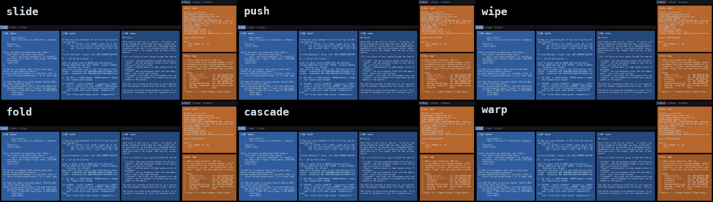

# ws-direction

A [picom](https://github.com/yshui/picom) plugin that tells animation scripts which way a
workspace switch went, and which monitor a window's workspace is on. With it a `show` or
`hide` animation can move windows the right way and keep them on their monitor. picom
itself knows nothing about workspaces: the plugin reads the window manager's EWMH
properties and hands the scripts five numbers. What the scripts do with them is up to
you; `styles/` has six to start from.

It needs a picom with plugin API 0.2, which adds the animation variable hook. No picom
release has it yet; the `hook-v2` branch of https://github.com/JornC/picom is picom's
`next` branch with the hook added. An older picom logs `ws-direction: picom is too old`
and runs without the variables.

## Install

    make
    make install

`make` builds `build/ws-direction.so` against the installed `<picom/api.h>`; to build
against a picom source tree instead, run `make PICOM_API_CFLAGS=-I/path/to/picom/include`.
`make install` copies the plugin to `~/.config/picom/plugins/` and the styles to
`~/.config/picom/include/ws-direction/`, where picom finds them by name. Then, in
`picom.conf`:

    plugins = "ws-direction.so";
    rules = ({
      match = "!override_redirect && window_type = 'normal'";
      @include "ws-direction/slide.conf"
    });

Without `make install`, give both by their full path. picom releases up to v13 only find
a plugin by name when it comes from `--plugins`, not from the config file (fixed in
yshui/picom#1547).

## Styles

Each style is one file in `styles/`. To switch, change the name in the `@include` line;
picom reloads by itself when you save `picom.conf`. Workspaces move along the short side
of each monitor: up and down on a landscape monitor, sideways on a portrait one. When an
animation is not part of a workspace switch, every style gives the window a short fade.

- **slide**: the new workspace pushes the old one out.
- **push**: the new workspace slides in over the old one, which drifts back and darkens,
  like a card put on a stack.
- **wipe**: nothing moves; an edge sweeps across the monitor and uncovers the new
  workspace.
- **fold**: the old workspace folds into one edge while the new one unfolds from the
  other, like a flat cube turning.
- **cascade**: the slide, but the windows start one after another and land together.
- **warp**: the old windows fly outward past you while the new ones come out of the
  middle of the monitor.

The GIFs are recorded on Xvfb with i3, at a quarter of a 3440x1440 + 1080x1920 layout,
with the windows cropped below the i3 bar; `docs/record-styles.sh` makes them.

The styles are plain picom animation scripts. To change one, copy it into your config
instead of including it; each file explains how it works.

## Variables

`workspace-direction`
: 1 if the new workspace sorts after the old one, -1 if before, 0 if the animation was
  not caused by a workspace switch on the window's monitor (a new window, scratchpad,
  fullscreen, a window moved to another workspace).

`workspace-monitor-x`, `workspace-monitor-y`, `workspace-monitor-width`,
`workspace-monitor-height`
: The monitor that shows the window's workspace. For other windows and triggers: the
  monitor that fully contains the window, else the whole screen (like
  `window-monitor-*`). For a window that closes: always the whole screen, as the window
  is gone and can't be looked up; use `window-monitor-*` there.

Workspaces sort in the order of `_NET_DESKTOP_NAMES`; under i3 that is the order of the
workspace numbers, with unnumbered names after them.

## How it works

The plugin reads `_NET_CURRENT_DESKTOP`, `_NET_DESKTOP_NAMES` and `_NET_DESKTOP_VIEWPORT`
on the root window and `_NET_WM_DESKTOP` on client windows, the monitors from RandR, and
a window's place with `GetGeometry`. The order in which a window manager changes these
properties and maps or unmaps windows is not specified, and the changes can reach picom
over several frames, so the plugin does not act on events. It remembers, per monitor,
the workspaces shown recently and when it last saw a part of each switch. When a window
starts an animation whose script reads a variable, it looks for a recent switch to or
away from the window's workspace on its monitor. All five variables of a window are
worked out in one go, and the root window is read once per picom update pass
(`start->frame`), however many windows start in it.

## Limits

- A switch is only seen when a window starts an animation whose script reads the
  variables. A switch made while picom is unredirected (`unredir-if-possible`) may not be
  seen; the next switch is then judged against the last workspace the plugin saw.
- Each animation start costs one round trip to the X server, on picom's main thread. On
  a quiet server that is about 20 us (median 17 to 18 us, p99 about 60 us, measured on
  Xvfb with i3). The reply waits behind whatever the server is doing, so under load a
  start can take milliseconds (p99 0.2 to 3 ms and a maximum of 5 to 7 ms in runs with a
  window manager and builds running), and N windows starting in one pass wait N times. A
  workspace switch under i3 starts 4 to 7 animations in one pass.
- A switch stays matched to its windows for 100 ms, or for 2 passes within 250 ms when
  frames are slow. On a heavily loaded machine a switch can take longer; the windows
  that come late then get 0.
- The plugin reads X on its own connection. The read happens after picom has handled the
  events of the pass, but it is not ordered against picom's own request queue.

## Tests

`tests/run.sh` starts a nested Xvfb with two monitors, i3 and a tiny fake window
manager, and checks the direction logged for every window that shows, opens or hides,
plus screenshots of slowed-down slides. It needs Xvfb, xrandr, i3, xterm, xdotool, xprop,
ImageMagick, a C compiler and a picom with the hook:

    make
    PICOM=/path/to/picom tests/run.sh

Run it alone, not next to builds. Set `WS_DIRECTION_LOG` to a file to log every decision
there, in picom's log format.
